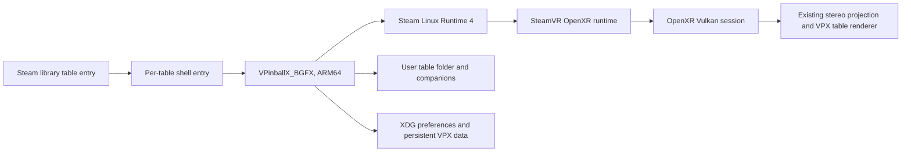

# Steam Frame VR architecture

This fork uses VPX's existing Linux, BGFX, Vulkan and OpenXR path. Frame support adds the
Valve interaction profile when the OpenXR runtime advertises it; it does not select a
different renderer or create a Frame-only application shell.

## Runtime route

- `VRDevice` selects Vulkan on Linux, enables `XR_KHR_vulkan_enable2`, creates the OpenXR
  instance, session, swapchains and the existing two-view projection path.
- It enables `XR_VALVE_frame_controller_interaction` only when the runtime advertises it.
  `XRInputHandler` then suggests the Frame profile at
  `/interaction_profiles/valve/frame_controller_valve` with the profile's explicit
  `VECTOR2F` thumbstick paths. It does not suggest squeeze-click or unsupported generic
  touch/trackpad components to that profile. The profile path and components follow the
  [Valve Steam Frame input documentation](https://partner.steamgames.com/doc/steamhardware/steamframe/input).
- If the extension is absent, the existing OpenXR profile suggestions and default mappings
  remain available. Saved InputManager mappings are still loaded and proposed defaults use
  VPX's existing apply-defaults flow.
- SteamVR owns headset presentation and frame pacing. The application submits both views
  through the same OpenXR projection layer used by the other supported VR runtimes.

## Frame controls

| Control | Default action |
| --- | --- |
| Left and right triggers | Left and right flippers; deeper pull also activates staged flippers |
| Left and right squeeze values | Left and right magna-save |
| Right A | Start; confirms when the in-game UI is open |
| Right B | Back while the in-game UI is open; no built-in table-exit action during play |
| Right X | Add credit |
| Right Menu | Open the existing in-game pause/settings UI |
| Left D-pad | Navigate the in-game UI |
| Right stick Y | Analog plunger pull |
| Left stick X/Y | Cabinet nudge X/Y |
| Left View, quick press | Back while the in-game UI is open |
| Left View, hold 1 second | Recenter the view |

The Frame profile exposes each thumbstick as a `VECTOR2F` action. VPX splits each vector into
the original scalar controller input IDs, so the existing plunger/nudge sensor mappings and
saved element IDs remain stable. On profile changes, VPX releases the old source before
sampling the selected source and re-emits an unchanged axis value when it becomes selected.
Unassigned controls remain available for user customization. When the action becomes inactive
on focus loss or profile change, button and axis state is released to avoid stuck flippers or
nudge input. This input path does not alter audio mute or volume state.

There is no three-second standing-height recalibration gesture for pinball: the player is seated
and table placement already relates the playfield to the physical floor and lockbar, so height
cannot be inferred from a seated pose. The existing per-table VR view offsets remain available.

## Persistent data

The executable bundle is installed under `~/devkit-game/VPXFrame` (override with
`VPX_FRAME_INSTALL_ROOT`). The `current` symlink changes between immutable build folders; it
does not contain user preferences or table files. The Steam entry passes
`-prefpath ${XDG_DATA_HOME:-$HOME/.local/share}/VPXFrame/10.8`, keeping settings and saves
separate from other VPX installations. Each launch sets `PlayerVR/AskToTurnOn=0` in that
dedicated preference file before starting the table.

Keep each user-owned table in its own folder with its companion files. Steam table entries
point to the table path directly. The build includes the upstream example table, but no user
or commercial tables, ROMs, or other user-owned content are bundled or tracked here. See
[Steam Frame build and table setup](SteamFrame.md).

## Acceptance boundary

Source and build configuration establish a native ARM64 OpenXR route, not a successful
headset session or stereoscopic image. Device acceptance still needs a Steam Linux Runtime 4
launch, OpenXR runtime/session logs, both-eye output confirmation, controller tests while
focused, standby/focus recovery, and a wearer-run comfort/play test. The existing source logs
identify the OpenXR runtime and session errors; build/session startup timings are logged for
diagnosis. No eye-image readback has been added, so stereo image evidence must come from
runtime capture or wearer inspection.
