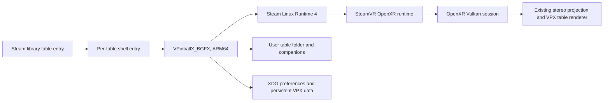

# Steam Frame VR architecture

This fork uses VPX's existing Linux, BGFX, Vulkan and OpenXR path. Frame support adds the
Valve interaction profile when the OpenXR runtime advertises it; it does not select a
different renderer or create a Frame-only application shell.

## Runtime route

- `VRDevice` selects Vulkan on Linux, enables `XR_KHR_vulkan_enable2`, creates the OpenXR
  instance, session, swapchains and the existing two-view projection path.
- It enables `XR_VALVE_frame_controller_interaction` only when the runtime advertises it.
  `XRInputHandler` then suggests the Frame profile at
  `/interaction_profiles/valve/frame_controller_valve` with the profile's explicit
  `VECTOR2F` thumbstick paths. It does not suggest squeeze-click or unsupported generic
  touch/trackpad components to that profile. The profile path and components follow the
  [Valve Steam Frame input documentation](https://partner.steamgames.com/doc/steamhardware/steamframe/input).
- If the extension is absent, the existing OpenXR profile suggestions and default mappings
  remain available. Saved InputManager mappings are still loaded and proposed defaults use
  VPX's existing apply-defaults flow.
- SteamVR owns headset presentation and frame pacing. The application submits both views
  through the same OpenXR projection layer used by the other supported VR runtimes.

## Frame controls

| Control | Default action |
| --- | --- |
| Left and right triggers | Left and right flippers; deeper pull also activates staged flippers |
| Left and right squeeze values | Left and right magna-save |
| Right A | Start; confirms when the in-game UI is open |
| Right B | Back while the in-game UI is open; no built-in table-exit action during play |
| Right X | Add credit |
| Right Menu | Open the existing in-game pause/settings UI |
| Left D-pad | Navigate the in-game UI |
| Right stick Y | Analog plunger pull |
| Left stick X/Y | Cabinet nudge X/Y |
| Left View, quick press | Back while the in-game UI is open |
| Left View, hold 1 second | Recenter the view |

The Frame profile exposes each thumbstick as a `VECTOR2F` action. VPX splits each vector into
the original scalar controller input IDs, so the existing plunger/nudge sensor mappings and
saved element IDs remain stable. On profile changes, VPX releases the old source before
sampling the selected source and re-emits an unchanged axis value when it becomes selected.
Unassigned controls remain available for user customization. When the action becomes inactive
on focus loss or profile change, button and axis state is released to avoid stuck flippers or
nudge input. This input path does not alter audio mute or volume state.

There is no three-second standing-height recalibration gesture for pinball: table placement
already relates the playfield to the physical floor and lockbar. A seated head pose does not
establish standing height. The existing per-table VR view offsets remain available.

## Persistent data

The executable bundle is installed under `~/devkit-game/VPXFrame` (override with
`VPX_FRAME_INSTALL_ROOT`). The `current` symlink changes between immutable build folders; it
does not contain user preferences or table files. The Steam entry passes
`-prefpath ${XDG_DATA_HOME:-$HOME/.local/share}/VPXFrame/10.8`, keeping settings and saves
separate from other VPX installations. Each launch sets `PlayerVR/AskToTurnOn=0` in that
dedicated preference file before starting the table.

Keep each user-owned table in its own folder with its companion files. Steam table entries
point to the table path directly. The build includes the upstream example table, but no user
or commercial tables, ROMs, or other user-owned content are bundled or tracked here. See
[Steam Frame build and table setup](SteamFrame.md).

## Verified build and startup

The native package from commit `b7a68edf6cf4233087958a58fb4024bae23d29ea` passed
[ARM64 CI run 41325381021](https://github.com/astromaddie/vpx-vr/actions/runs/41325381021).
Its archive SHA-256 is
`1ff651443e5fcd1440b74f3c451b6b07d933b708e3ac3bf5388ea25e6cf5a9a8`.
The installed executable is an AArch64 ELF PIE; its SHA-256 is
`419c7a2080e000ee72242b86e260e92306f4dd6a309fc1baf33788755a93eeac`.
All 3,562 packaged file hashes passed verification before installation.

On 2026-11-02, the bundled example and the supplied 4 Queens 1.2 table loaded through
Steam Linux Runtime 4 and created SteamVR/OpenXR 2.18.2 sessions with two 1728×1728 views.
The runtime accepted all 20 explicit Frame controller bindings. These startup checks used
the `521ca05` executable; the engine C++ sources are identical in `b7a68ed`, which changes
table registration tooling, its tests, and documentation. Both sessions were stopped through
Steam and the speaker and EQ sink mute/volume states matched their pre-test values.

The 4 Queens input file remained unchanged at SHA-256
`f5e6ca897820ce0d12c426c3a646b6f66469341025be5de3a609b9914e7e3805`.
Its current Steam display name is `Devkit Game: VPX_4_Queens`. Black Hole BigusMOD 2.0 is
also imported; its default ROM set requires the separately supplied `blkhole2.zip`.

Reproduction details: relative launcher paths must live under `~/devkit-game/<gameid>`;
the shortcut helper's `directory` field does not change Steam's path resolution. Automated
Steam stop calls use the unsigned 64-bit game ID as a string. For this device's 4 Queens
entry that is `13227685663173771264`, rather than the 32-bit shortcut AppID `3079810567`.

Startup logged an SDL desktop-backbuffer-format error, then selected RGBA8 and initialized
the Vulkan backend and OpenXR session. Session creation establishes initialization, not
rendered stereo, frame pacing, physical controls, or comfort.

Active rendering currently fails: normal Steam launches on 2026-11-02 at 09:21:50 and
09:22:12 JST loaded 4 Queens, then received SIGSEGV at 09:21:54 and 09:22:16. The example
table launch at 09:22:37 failed at 09:22:41 with the same stack. The crashing thread enters
`vkUpdateDescriptorSets` from BGFX `RendererContextVK::getDescriptorSet`, then faults in
`libvulkan_freedreno.so+0xb2bd98`. Installed BGFX disassembly places its call at
`libbgfx.so+0x125edc`; the saved return address is `+0x125ee0`. This is a shared render-path
failure, with no table-script error found in these logs. The exact invalid state remains
under investigation. The earlier synchronized, off-head sessions skipped active rendering.

Reproduce through the normal Steam entry using the opt-in bounded standby rendering
diagnostic described in [SteamFrame.md](SteamFrame.md#off-head-vulkan-crash-diagnostic).
Use the installed API-dump layer to inspect descriptor writes and their corresponding
layouts. Diagnostic frames do not establish headset appearance or physical control behavior.

Further same-binary checks isolated the first three descriptor writes: sampled image at
binding 3 and dynamic UBO at binding 0 each returned, while the sampler at binding 19 alone
reproduced SIGSEGV. GDB stopped each successful case immediately after the Vulkan call,
before any draw. The faulting sampler destination was the last 32 bytes of a 5 MiB
`/dev/dri/renderD128` mapping; the writer's padding crossed into an unmapped page.

The descriptor-only Python probe then passed all three layouts inside Steam Linux Runtime 4
on the same Turnip driver (`Mesa 26.3.0-devel`, `git-e07916b45f`). It uses the exact BGFX pool
sizes and recorded sampler configuration, but an ordinary `vkCreateDevice` with no optional
extensions/features. VPX's failing resources belong to the OpenXR-created Vulkan device.
The probe result does not identify a generic driver sampler or sparse-binding defect;
device creation, dispatch and VPX/BGFX resource state remain under investigation.

The bounded-render diagnostic package from source `9f695609263782197070f20aeba282db8f2fe506`
also passed [ARM64 CI run 41371818188](https://github.com/astromaddie/vpx-vr/actions/runs/41371818188),
including all 3,562 package file hashes. Its executable SHA-256 is
`927e8073ee31888a13d0a58c21e03fa9ff2c9c423d2e86af27a9e75f995bbe65`.
It has not replaced the installed `b7a68ed` package; it adds diagnostics rather than a crash fix.
