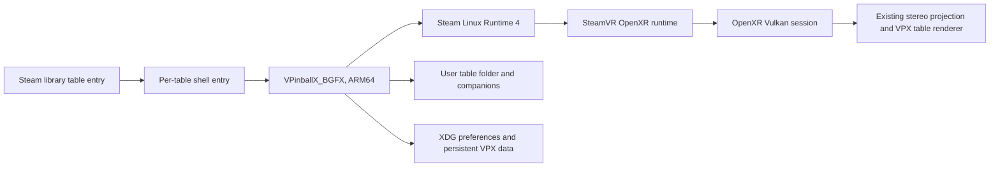

# Steam Frame VR architecture

This fork uses VPX's existing Linux, BGFX, Vulkan and OpenXR path. Frame support adds the
Valve interaction profile when the OpenXR runtime advertises it; it does not select a
different renderer or create a Frame-only application shell.

## Runtime route

- `VRDevice` selects Vulkan on Linux, enables `XR_KHR_vulkan_enable2`, creates the OpenXR
  instance, session, swapchains and the existing two-view projection path.
- It enables `XR_VALVE_frame_controller_interaction` only when the runtime advertises it.
  `XRInputHandler` then suggests the Frame profile at
  `/interaction_profiles/valve/frame_controller_valve` with the profile's explicit
  `VECTOR2F` thumbstick paths. It does not suggest squeeze-click or unsupported generic
  touch/trackpad components to that profile. The profile path and components follow the
  [Valve Steam Frame input documentation](https://partner.steamgames.com/doc/steamhardware/steamframe/input).
- If the extension is absent, the existing OpenXR profile suggestions and default mappings
  remain available. Saved InputManager mappings are still loaded and proposed defaults use
  VPX's existing apply-defaults flow.
- SteamVR owns headset presentation and frame pacing. The application submits both views
  through the same OpenXR projection layer used by the other supported VR runtimes.

## Foveation

`[PlayerVR] Foveation` selects how each eye is rendered (read when the table starts; the
environment variable `VPX_VR_FOVEATION=0|1` overrides it for A/B runs):

| Value | Mode |
| --- | --- |
| 0 `Off` (default) | Two full resolution views, exactly as without foveation |
| 1 `Fixed` | Six internal views, sharp and middle areas centred on each eye's optical axis |

Value 2 is reserved for eye tracked foveation, which is not implemented.

With `Fixed`, the scene render targets are 6-layer texture arrays of 576×576 pictures
(`VPX::Fovea::PictureSize`). Layer `picture * 2 + eye` holds the coarse picture (the whole eye
frustum, the same projection as without foveation), then the middle and sharp windows. Windows
are asymmetric crops of the eye frustum: same view matrix, near and far planes, only the
projection differs. All six views are drawn with one instanced submission per pass, like the
two eyes are without foveation. OpenXR still receives one projection layer with the two
runtime eye poses and FOVs.

`ComposeFoveation` (`fs_pp_fovea_compose.sc`) rebuilds the two eyes at full resolution in
linear HDR, before bloom and tonemapping: round windows with a quintic feather, blended coarse,
then middle, then sharp, with a 1/255 dither of the blend weight inside the feather bands. The
coarse picture is upsampled with a slightly eased bilinear filter. A window never contributes
at or beyond its support radius (0.98 of its half side), and near that edge the bilinear
filter drops texels whose centre lies outside the support, so the square corners of a window
cannot leak. Depth is selected, never blended, from the most detailed picture contributing at
least half of the colour. Everything after the composition (SSR, bloom, tonemap, AA,
sharpening, XR depth copy, desktop mirror) runs on the composed eyes unchanged.

The window sizes and the feather apply live, from the VR settings page or the settings file:

| Setting | Default | Meaning |
| --- | --- | --- |
| `FoveationSharpSize` | 16° | Angle from the optical axis to the middle of the sharp area's feather |
| `FoveationMiddleSize` | 35° | Same for the middle area |
| `FoveationFeather` | 43 % | Feather width, as a percentage of each area's radius |

With the defaults and the Frame's eye FOV, the pictures have about 0.27 (coarse), 0.42
(middle) and 1.02 (sharp) of the linear density of a 2160×2160 eye. The layout maths are in
`src/renderer/FoveaLayout.h`, tested by `tests/render/test-fovealayout.cpp`.

| Effect | With foveation |
| --- | --- |
| Geometry, depth, lighting, ball shadows | Per picture |
| Transmitted bulb light | Per picture, in dedicated 6-layer quarter resolution buffers; the blur tap spacing is scaled per picture so it covers the same part of the eye |
| Playfield and plane reflection probes | Per picture; roughness blur scaled per picture as above |
| Screen-space refraction probes | Per picture copy of colour and depth |
| Ball playfield reflection (previous frame) | Same picture of the previous frame; reflected points outside a window use the coarse picture of the same eye |
| SSR, bloom, tonemap, dither, post AA, sharpening | Composed eyes |
| AO, ball motion blur, static prerender | Disabled in VR, as without foveation |
| Hidden area mask | Not applied to the pictures |
| Desktop display scene render | Not available; the desktop display mirrors the composed eyes |

Diagnostics: `VPX_VR_SCREENSHOT_ALL=<seconds>:<prefix>` saves, once, `<prefix>-eye0.png` and
`<prefix>-eye1.png` (final eyes), and with foveation `<prefix>-fovea-eye0/1.png` (composed
eyes before postprocessing, clamped and sRGB encoded) and `<prefix>-view0.png` to `view5.png`
(the internal pictures; not captured with MSAA). With `VPX_VR_PERF`, the composition appears
as `Foveation Compose [RT=FoveaEye]` and the per picture blurs carry their layer
(`... / Layer=n`).

Known gaps:

- Each pass draws three times as many instances; reflection probes multiply that again.
  Per picture blurs are separate passes (two per picture).
- Refraction lookups that leave a window's picture are clamped to its edge instead of
  falling back to the coarse picture.
- The hidden area mask is not applied, so the corners of the coarse pictures are shaded.
- Derivative based filtering (DMD, CRT, segment displays) and the ball reflection's texel
  offsets follow each picture's own density.
- Eye tracked foveation is not implemented.

## Frame controls

| Control | Default action |
| --- | --- |
| Left and right triggers | Left and right flippers; deeper pull also activates staged flippers |
| Left and right squeeze values | Left and right magna-save |
| Right A | Start; confirms when the in-game UI is open |
| Right B | Back while the in-game UI is open; no built-in table-exit action during play |
| Right X | Add credit |
| Right Menu | Open the existing in-game pause/settings UI |
| Left D-pad | Navigate the in-game UI |
| Right stick Y | Analog plunger pull |
| Left stick X/Y | Cabinet nudge X/Y |
| Left View, quick press | Back while the in-game UI is open |
| Left View, hold 1 second | Recenter the view |

The Frame profile exposes each thumbstick as a `VECTOR2F` action. VPX splits each vector into
the original scalar controller input IDs, so the existing plunger/nudge sensor mappings and
saved element IDs remain stable. On profile changes, VPX releases the old source before
sampling the selected source and re-emits an unchanged axis value when it becomes selected.
Unassigned controls remain available for user customization. When the action becomes inactive
on focus loss or profile change, button and axis state is released to avoid stuck flippers or
nudge input. This input path does not alter audio mute or volume state.

There is no three-second standing-height recalibration gesture for pinball: table placement
already relates the playfield to the physical floor and lockbar. A seated head pose does not
establish standing height. The existing per-table VR view offsets remain available.

## Persistent data

The executable bundle is installed under `~/devkit-game/VPXFrame` (override with
`VPX_FRAME_INSTALL_ROOT`). The `current` symlink changes between immutable build folders; it
does not contain user preferences or table files. The Steam entry passes
`-prefpath ${XDG_DATA_HOME:-$HOME/.local/share}/VPXFrame/10.8`, keeping settings and saves
separate from other VPX installations. Each launch sets `PlayerVR/AskToTurnOn=0` in that
dedicated preference file before starting the table.

Keep each user-owned table in its own folder with its companion files. Steam table entries
point to the table path directly. The build includes the upstream example table, but no user
or commercial tables, ROMs, or other user-owned content are bundled or tracked here. See
[Steam Frame build and table setup](SteamFrame.md).

## Verified build and startup

The package from commit `0fb8011ceeb6b093a221b8c07f18f988fa678284` passed
[ARM64 CI run 41378642429](https://github.com/astromaddie/vpx-vr/actions/runs/41378642429).
Its archive SHA-256 is
`49861e69467dcfc94a7347c395f7e486a610666747d61c4250b6bea1c965a3b7`, and the installed
AArch64 executable's SHA-256 is
`2baa03ae52c493ad097266c9d14b613e15f61fa8f349b9fe46db10b416e1cd70`. The installer verified
every packaged file hash.

On 2026-11-02 the supplied 4 Queens 1.2 table, launched from its Steam entry, created a
SteamVR/OpenXR 2.18.2 session with two 1728×1728 views and rendered until it was stopped
through Steam 72 seconds later. The compositor counted 5,120 presents, 10 dropped and 3,144
reprojected, with an average application time of 13.2 ms CPU and 17.9 ms GPU against the
72 Hz target. The runtime accepts all 20 explicit Frame controller bindings. The speaker and
EQ sink mute/volume states matched their values from before the test.

The 4 Queens input file is unchanged at SHA-256
`f5e6ca897820ce0d12c426c3a646b6f66469341025be5de3a609b9914e7e3805`.
Its Steam display name is `Devkit Game: VPX_4_Queens`. Black Hole BigusMOD 2.0 is also
imported; its default ROM set requires the separately supplied `blkhole2.zip`.

Reproduction details: relative launcher paths must live under `~/devkit-game/<gameid>`;
the shortcut helper's `directory` field does not change Steam's path resolution. Automated
Steam stop calls use the unsigned 64-bit game ID as a string. For this device's 4 Queens
entry that is `13227685663173771264`, rather than the 32-bit shortcut AppID `3079810567`.
Startup logs an SDL desktop-backbuffer-format error, then selects RGBA8 and initializes the
Vulkan backend and OpenXR session.

## Turnip descriptor pool workaround

Earlier builds crashed in `vkUpdateDescriptorSets` on the first rendered frame of every
table. The cause is in Mesa Turnip (`Mesa 26.3.0-devel`, `git-e07916b45f` on the Frame, and
current upstream): `tu_ResetDescriptorPool` rebuilds a `FREE_DESCRIPTOR_SET` pool's VMA heap
with `util_vma_heap_init(heap, 32, size + 32)`, which spans 32 bytes more than the pool's BO,
and leaves the heap allocating from the top. The first set allocated after a reset therefore
ends 32 bytes past the BO. BGFX resets its per-frame pools before allocating from them, and
its pool is exactly 5 MiB, so the overrun reaches an unmapped page. Pools whose size is not a
multiple of the page size overrun into padding instead, which is why other Vulkan apps and
in-process layers on the Frame do not fault.

BGFX never frees individual descriptor sets, so the Linux ARM64 build patches its pools to
be created without `VK_DESCRIPTOR_POOL_CREATE_FREE_DESCRIPTOR_SET_BIT`
([`platforms/linux-aarch64/bgfx-turnip-descriptor-pool.patch`](../platforms/linux-aarch64/bgfx-turnip-descriptor-pool.patch)).
Turnip then uses its linear pool allocator, which resets correctly. The descriptor probe in
[SteamFrame.md](SteamFrame.md#descriptor-pool-probe) reproduces the fault and the fix
without VPX: on the Frame, `reset_free_set_pool` ends with SIGSEGV and `reset_linear_pool`
returns normally.
