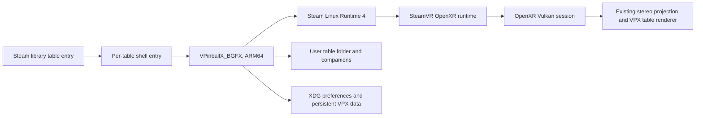

# Steam Frame VR architecture

This fork uses VPX's existing Linux, BGFX, Vulkan and OpenXR path. Frame support adds the
Valve interaction profile when the OpenXR runtime advertises it; it does not select a
different renderer or create a Frame-only application shell.

## Runtime route

- `VRDevice` selects Vulkan on Linux, enables `XR_KHR_vulkan_enable2`, creates the OpenXR
  instance, session, swapchains and the existing two-view projection path.
- It enables `XR_VALVE_frame_controller_interaction` only when the runtime advertises it.
  `XRInputHandler` then suggests the Frame profile at
  `/interaction_profiles/valve/frame_controller_valve` with the profile's explicit
  `VECTOR2F` thumbstick paths. It does not suggest squeeze-click or unsupported generic
  touch/trackpad components to that profile. The profile path and components follow the
  [Valve Steam Frame input documentation](https://partner.steamgames.com/doc/steamhardware/steamframe/input).
- If the extension is absent, the existing OpenXR profile suggestions and default mappings
  remain available. Saved InputManager mappings are still loaded and proposed defaults use
  VPX's existing apply-defaults flow.
- SteamVR owns headset presentation and frame pacing. The application submits both views
  through the same OpenXR projection layer used by the other supported VR runtimes.

## Frame controls

| Control | Default action |
| --- | --- |
| Left and right triggers | Left and right flippers; deeper pull also activates staged flippers |
| Left and right squeeze values | Left and right magna-save |
| Right A | Start; confirms when the in-game UI is open |
| Right B | Back while the in-game UI is open; no built-in table-exit action during play |
| Right X | Add credit |
| Right Menu | Open the existing in-game pause/settings UI |
| Left D-pad | Navigate the in-game UI |
| Right stick Y | Analog plunger pull |
| Left stick X/Y | Cabinet nudge X/Y |
| Left View, quick press | Back while the in-game UI is open |
| Left View, hold 1 second | Recenter the view |

The Frame profile exposes each thumbstick as a `VECTOR2F` action. VPX splits each vector into
the original scalar controller input IDs, so the existing plunger/nudge sensor mappings and
saved element IDs remain stable. On profile changes, VPX releases the old source before
sampling the selected source and re-emits an unchanged axis value when it becomes selected.
Unassigned controls remain available for user customization. When the action becomes inactive
on focus loss or profile change, button and axis state is released to avoid stuck flippers or
nudge input. This input path does not alter audio mute or volume state.

There is no three-second standing-height recalibration gesture for pinball: table placement
already relates the playfield to the physical floor and lockbar. A seated head pose does not
establish standing height. The existing per-table VR view offsets remain available.

## Persistent data

The executable bundle is installed under `~/devkit-game/VPXFrame` (override with
`VPX_FRAME_INSTALL_ROOT`). The `current` symlink changes between immutable build folders; it
does not contain user preferences or table files. The Steam entry passes
`-prefpath ${XDG_DATA_HOME:-$HOME/.local/share}/VPXFrame/10.8`, keeping settings and saves
separate from other VPX installations. Each launch sets `PlayerVR/AskToTurnOn=0` in that
dedicated preference file before starting the table.

Keep each user-owned table in its own folder with its companion files. Steam table entries
point to the table path directly. The build includes the upstream example table, but no user
or commercial tables, ROMs, or other user-owned content are bundled or tracked here. See
[Steam Frame build and table setup](SteamFrame.md).

## Verified build and startup

The package from commit `0fb8011ceeb6b093a221b8c07f18f988fa678284` passed
[ARM64 CI run 41378642429](https://github.com/astromaddie/vpx-vr/actions/runs/41378642429).
Its archive SHA-256 is
`49861e69467dcfc94a7347c395f7e486a610666747d61c4250b6bea1c965a3b7`, and the installed
AArch64 executable's SHA-256 is
`2baa03ae52c493ad097266c9d14b613e15f61fa8f349b9fe46db10b416e1cd70`. The installer verified
every packaged file hash.

On 2026-11-02 the supplied 4 Queens 1.2 table, launched from its Steam entry, created a
SteamVR/OpenXR 2.18.2 session with two 1728×1728 views and rendered until it was stopped
through Steam 72 seconds later. The compositor counted 5,120 presents, 10 dropped and 3,144
reprojected, with an average application time of 13.2 ms CPU and 17.9 ms GPU against the
72 Hz target. The runtime accepts all 20 explicit Frame controller bindings. The speaker and
EQ sink mute/volume states matched their values from before the test.

The 4 Queens input file is unchanged at SHA-256
`f5e6ca897820ce0d12c426c3a646b6f66469341025be5de3a609b9914e7e3805`.
Its Steam display name is `Devkit Game: VPX_4_Queens`. Black Hole BigusMOD 2.0 is also
imported; its default ROM set requires the separately supplied `blkhole2.zip`.

Reproduction details: relative launcher paths must live under `~/devkit-game/<gameid>`;
the shortcut helper's `directory` field does not change Steam's path resolution. Automated
Steam stop calls use the unsigned 64-bit game ID as a string. For this device's 4 Queens
entry that is `13227685663173771264`, rather than the 32-bit shortcut AppID `3079810567`.
Startup logs an SDL desktop-backbuffer-format error, then selects RGBA8 and initializes the
Vulkan backend and OpenXR session.

## Turnip descriptor pool workaround

Earlier builds crashed in `vkUpdateDescriptorSets` on the first rendered frame of every
table. The cause is in Mesa Turnip (`Mesa 26.3.0-devel`, `git-e07916b45f` on the Frame, and
current upstream): `tu_ResetDescriptorPool` rebuilds a `FREE_DESCRIPTOR_SET` pool's VMA heap
with `util_vma_heap_init(heap, 32, size + 32)`, which spans 32 bytes more than the pool's BO,
and leaves the heap allocating from the top. The first set allocated after a reset therefore
ends 32 bytes past the BO. BGFX resets its per-frame pools before allocating from them, and
its pool is exactly 5 MiB, so the overrun reaches an unmapped page. Pools whose size is not a
multiple of the page size overrun into padding instead, which is why other Vulkan apps and
in-process layers on the Frame do not fault.

BGFX never frees individual descriptor sets, so the Linux ARM64 build patches its pools to
be created without `VK_DESCRIPTOR_POOL_CREATE_FREE_DESCRIPTOR_SET_BIT`
([`platforms/linux-aarch64/bgfx-turnip-descriptor-pool.patch`](../platforms/linux-aarch64/bgfx-turnip-descriptor-pool.patch)).
Turnip then uses its linear pool allocator, which resets correctly. The descriptor probe in
[SteamFrame.md](SteamFrame.md#descriptor-pool-probe) reproduces the fault and the fix
without VPX: on the Frame, `reset_free_set_pool` ends with SIGSEGV and `reset_linear_pool`
returns normally.

## Texture memory budget

With BGFX, `TextureManager` keeps uploaded table images inside 85% of the GPU memory budget
that `bgfx::Stats::gpuMemoryMax` reports. On Vulkan that is `VK_EXT_memory_budget`, summed
over device-local heaps. Turnip exposes one shared heap and bounds its budget by
`/proc/meminfo` `MemAvailable`, so the figure is an allocation budget rather than free
memory. The render thread copies `gpuMemoryMax`, `gpuMemoryUsed` and `gpuFrameNum` right
after each `bgfx::frame()`, and the manager reads that copy instead of the live stats.

When an upload does not fit, the manager evicts least recently used samplers down to 70%.
It skips samplers that something else still references (bound shader state, ImGui, queued
uploads), because dropping them frees nothing. A dropped sampler's bytes stay accounted until
the sampler is actually destroyed, then for four more frames while BGFX releases it. If the
upload still does not fit, the image is box-downsized, from the decoded bitmap when one is
alive and otherwise by decoding the file at the smaller size. The size is picked to fit the
room left, and the copy is never cached as the image's bitmap. Only then does the image fall
back to the magenta checkerboard. Degraded images retry full size every 60 frames once they
fit below 70%. The estimate counts the mip chain. Once the textures exist, each sampler
reports what it really allocated, including a base level kept alongside the mips, and the
estimate is raised to that.

ImGui textures (the font atlas) and the table's color grading LUT are pinned: they are never
evicted, downsized or replaced by the checkerboard, and are admitted over the cap if needed.
If the LUT image cannot be decoded, color grading is turned off and an error is logged,
instead of grading through the checkerboard.

Diagnostics and overrides:

- Every budget decision logs one line starting with `TexBudget:`, at most every 2 s, with a
  count of suppressed lines. It has the decision and image, the upload size, the effective
  budget with the driver figure and any override, the 85% cap, the driver's used figure, the
  manager's managed, retired, pending-free and other bytes, the projected use, and
  `MemAvailable` in MB. One line is also logged on the first budget sample after startup.
- `[Player] GPUMemoryBudget` (MB, default 0) replaces the driver's budget figure; 0 keeps the
  driver's figure. `VPX_GPU_MEMORY_BUDGET=<MB>` in the environment overrides the setting, and
  `VPX_GPU_MEMORY_BUDGET=0` forces the driver's figure. A higher budget only moves the
  admission limit; the allocation can still fail if the system runs out of memory.
- `BGFX_VK_DESCRIPTOR_CACHE` controls BGFX's per-frame descriptor-set cache in the Linux ARM64
  build ([`bgfx-vk-descriptor-cache-diagnostic.patch`](../platforms/linux-aarch64/bgfx-vk-descriptor-cache-diagnostic.patch)).
  The cache reuses a set when a 32-bit hash matches, without comparing the key, and the key
  leaves out the program's texture view types. Unset or `1` keeps the default. `0` bypasses
  the cache and writes a set for every draw and dispatch. `verify` keeps the cache but compares
  the full key on each hit, and logs one warning on a hash collision and one when a set is
  reused across programs with different texture metadata. Setting the variable logs
  `BGFX VK descriptor cache: mode ...` once. Writing a set also records the image layout
  transitions of its textures, so a fault that goes away under `0` points at either the
  cache identity or a layout transition skipped on reuse; `verify` tells the first apart.

## Packed HDR render targets

VPX asks for its HDR render targets as `RGB16F`, which BGFX stores as `RGBA16F`, 8 bytes per
pixel. With `[Player] PackedHDR` on, every `RGB16F` target is created as `RG11B10F` instead:
4 bytes per pixel, unsigned floats with 6/6/5 mantissa bits and the same range as half
floats, no alpha. The setting defaults to on for standalone Linux ARM64 XR builds
(`VPX_STANDALONE_XR_DEFAULTS`) and off everywhere else. `VPX_PACKED_HDR=0|1` overrides it.
It only applies to BGFX builds and is read once at startup.

Packed:

- Main scene buffers (both eye layers), including the previous frame the ball samples for
  its playfield reflection, and the VR desktop mirror's scene buffers.
- Playfield reflection probes and refraction (screen-space transparency) probes, with their
  roughness blur targets.
- Bloom and transmitted-light ping-pong buffers.
- The SSR buffer (off by default), and the motion blur buffer and static prerender, which VR
  does not use.

Not packed, because they are created as `RGBA16F` or another format on purpose:

- The environment irradiance target and ancillary window HDR buffers (`RGBA16F`).
- Post-process, AO and swapchain targets, which are 8 or 10 bit already.

Why alpha and negative values are not a problem: no pass reads alpha back from an `RGB16F`
target (all post-process, probe and ball shaders sample `.rgb`), no blend state uses
destination alpha, and desktop OpenGL already allocates these targets as alpha-less
`GL_RGB16F`. Lights and additive flashers write negative colours, but only as the source of a
reverse-subtract blend whose result stays positive; Vulkan does not clamp blend inputs for
float attachments, and only the stored result is clamped at zero.

All targets switch together, because the refraction probe and the static prerender are
copied from the scene buffer with `vkCmdCopyImage`, which needs matching formats. Startup
checks that BGFX can render to `RG11B10F` at the selected MSAA sample count and, through the
XR Vulkan backend, that the physical device reports colour attachment, blend, linear
filtering and transfer support for `VK_FORMAT_B10G11R11_UFLOAT_PACK32`. If any check fails
it falls back to `RGBA16F`. One line starting with `Packed HDR render targets:` logs the
decision and its source.

Upstream briefly mapped `RGB16F` to `RG11B10F` on Android (vpinball PR #3934) and dropped
it in a mobile cleanup commit (PR #4074) without giving a reason. The visible cost of the
format is precision: about 1.6% steps in red and green and 3.1% in blue, which can show as
banding or a slight hue shift in bright, smooth gradients and in heavily stacked light
blending.
